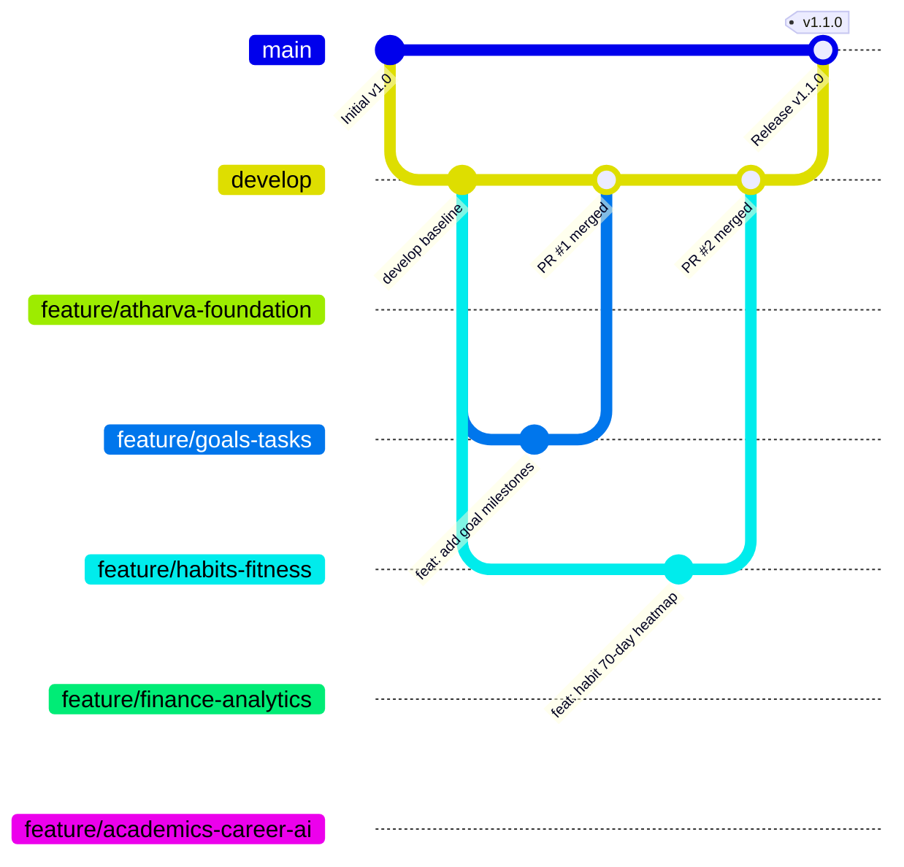

# LIFE OS — Multi-Developer Collaboration & Team Workflow Guide

> **Authoritative Specification**: This document governs repository management, branch strategy, module boundaries, code review standards, and conflict prevention for the 5-engineer team building **LIFE OS**.

---

## 1. Repository Architecture & Layout

```text
life-os/
├── .github/
│   └── pull_request_template.md    # Mandatory PR submission template
├── dist/                           # Compiled production artifacts (gitignored)
├── node_modules/                   # Dependencies (gitignored)
├── public/                         # Static public assets
├── src/
│   ├── assets/                     # Shared static icons and images
│   ├── components/                 # Shared UI & modular widgets
│   │   ├── GoalCard.tsx            # [Team Member 2]
│   │   ├── GoalModal.tsx           # [Team Member 2]
│   │   ├── HabitCard.tsx           # [Team Member 3]
│   │   ├── HabitModal.tsx          # [Team Member 3]
│   │   ├── Sidebar.tsx             # [Atharva] Foundation Shell
│   │   ├── TaskItem.tsx            # [Team Member 2]
│   │   ├── TaskModal.tsx           # [Team Member 2]
│   │   └── ThemeToggle.tsx         # [Atharva] Foundation Theme
│   ├── db/                         # [Core / Atharva] Dexie.js IndexedDB schema & repos
│   │   ├── index.ts                # Database tables, versions & schema indices
│   │   ├── repository.ts           # Type-safe transactional queries
│   │   └── seedData.ts             # Default mock and baseline database entries
│   ├── pages/                      # Domain Pages
│   │   ├── AcademicsPage.tsx       # [Team Member 5]
│   │   ├── AnalyticsPage.tsx       # [Team Member 4]
│   │   ├── AssistantPage.tsx       # [Team Member 5] AI Copilot
│   │   ├── CareerPage.tsx          # [Team Member 5]
│   │   ├── Dashboard.tsx           # [Atharva] Central Operations
│   │   ├── EveningReviewPage.tsx   # [Team Member 5]
│   │   ├── FinancePage.tsx         # [Team Member 4]
│   │   ├── FitnessPage.tsx         # [Team Member 3]
│   │   ├── GoalsPage.tsx           # [Team Member 2]
│   │   ├── HabitsPage.tsx          # [Team Member 3]
│   │   ├── ObsidianPage.tsx        # [Team Member 5] Markdown Vault
│   │   ├── ReviewHistoryPage.tsx   # [Team Member 5]
│   │   ├── SettingsPage.tsx        # [Atharva] System Preferences
│   │   └── TasksPage.tsx           # [Team Member 2]
│   ├── store/
│   │   └── useStore.ts             # [Core / Atharva] Central Zustand state store
│   ├── types/
│   │   └── index.ts                # [Core / Atharva] Central TypeScript domain types
│   ├── utils/                      # Reusable utilities
│   │   ├── notifications.ts        # Desktop notifications
│   │   └── storage.ts              # Local storage helpers
│   ├── App.tsx                     # [Atharva] Root shell, router, top toolbar
│   ├── index.css                   # [Atharva] Design tokens, typography, CSS vars
│   └── main.tsx                    # React DOM bootstrap
├── .gitignore                      # Safe ignore list (secrets, builds, node_modules)
├── e2e-test.mjs                    # Playwright end-to-end regression suite
├── package.json                    # Project dependencies
├── TEAM_WORKFLOW.md                # This collaboration guide
└── TEAM_QUICKSTART.md              # Copy-paste developer onboarding cheatsheet
```

---

## 2. Git Branching Strategy

We enforce a strict **`feature branch → develop → main`** architecture:



### The Three Tiers:

1. **`main` (Production / Stable Release)**
   - **Protection Level**: Locked.
   - **Rule**: Absolutely **zero** direct commits or feature pushes.
   - Only approved, tested releases from `develop` are merged into `main`.
2. **`develop` (Integration Branch)**
   - **Protection Level**: Protected.
   - **Rule**: All 5 feature branches branch off `develop`.
   - Feature branches merge back into `develop` exclusively through GitHub Pull Requests.
   - No direct pushing to `develop`.
3. **`feature/*` (Isolated Developer Workspaces)**
   - Every developer works in their dedicated branch.
   - Pushes happen frequently to their upstream branch.

---

## 3. Team Member Assignments & File Ownership

To prevent merge conflicts in advance, each engineer is assigned strict ownership boundaries.

| Person | Branch Name | Primary Domain | Owned Files & Directories |
|---|---|---|---|
| **Atharva (Team Lead)** | `feature/atharva-foundation` | Design System, App Shell, Dashboard | `src/index.css`, `src/App.tsx`, `src/components/Sidebar.tsx`, `src/components/ThemeToggle.tsx`, `src/pages/Dashboard.tsx`, `src/pages/SettingsPage.tsx`, Shared UI standards. |
| **Team Member 2** | `feature/goals-tasks` | Goals, Priorities, Tasks | `src/pages/GoalsPage.tsx`, `src/components/GoalCard.tsx`, `src/components/GoalModal.tsx`, `src/pages/TasksPage.tsx`, `src/components/TaskItem.tsx`, `src/components/TaskModal.tsx`. |
| **Team Member 3** | `feature/habits-fitness` | Habits, Streaks, Fitness | `src/pages/HabitsPage.tsx`, `src/components/HabitCard.tsx`, `src/components/HabitModal.tsx`, `src/pages/FitnessPage.tsx`. |
| **Team Member 4** | `feature/finance-analytics` | Wealth & Productivity Intelligence | `src/pages/FinancePage.tsx`, `src/pages/AnalyticsPage.tsx`. |
| **Team Member 5** | `feature/academics-career-ai` | Academics, Career, AI, Obsidian | `src/pages/AcademicsPage.tsx`, `src/pages/CareerPage.tsx`, `src/pages/AssistantPage.tsx`, `src/pages/ObsidianPage.tsx`, `src/pages/EveningReviewPage.tsx`, `src/pages/ReviewHistoryPage.tsx`. |

---

## 4. Conflict Prevention & Shared Core Protocol

### Rule 1: Shared Design Tokens Belong to Foundation
- **Do not invent arbitrary colors, font families, margins, or padding in your components.**
- Always reference the CSS variables established in `src/index.css` by Atharva:
  - Surfaces: `var(--bg-main)`, `var(--bg-surface)`, `var(--bg-elevated)`
  - Text: `var(--text-primary)`, `var(--text-secondary)`, `var(--text-muted)`
  - Accents: `var(--accent-primary)`, `var(--status-danger)`, `var(--status-success)`
  - Radii: `var(--radius-small)` (4px), `var(--radius-medium)` (6px)
  - Numerals: Add `font-variant-numeric: tabular-nums` or the `.tabular` utility class for any numbers, dates, or financial amounts.

### Rule 2: Strictly Enforce Anti-AI-Slop Rules
- **No purple-to-blue gradients** (`#7c5cfc`, neon purple buttons).
- **No glassmorphism / frosted glass cards**.
- **No arbitrary emoji interface buttons**.
- **Use solid, well-defined surfaces and clear typographic hierarchy.**

### Rule 3: Database & Type Changes Require RFC Coordination
- The files `src/types/index.ts`, `src/db/index.ts`, `src/db/repository.ts`, and `src/store/useStore.ts` are **Shared Core Infrastructure**.
- If a developer requires a new table or state method:
  1. Open an issue or communicate with the team lead (Atharva).
  2. Add isolated fields without breaking existing types.
  3. Increment the Dexie database schema version cleanly in `src/db/index.ts`.
  4. Never rename or delete columns without backward-compatible migrations.

### Rule 4: Zero Package Drift
- Do **not** run `npm install <package>` without team alignment.
- Adding dependencies unnecessarily bloats the client bundle and creates lockfile churn.

### Rule 5: Never Commit Secrets
- Keep `.env`, API keys, private tokens, and credentials strictly local.
- `.gitignore` is configured to reject `.env*`, `*.pem`, `*.key`.

---

## 5. Commit Naming Conventions

We adhere to the **Conventional Commits** specification:

```text
<type>(<scope>): <short imperative summary>

[optional body]
```

### Allowed Types:
- `feat`: A new user-facing feature.
- `fix`: A bug fix.
- `refactor`: Code change that neither fixes a bug nor adds a feature.
- `style`: Formatting, whitespace, visual alignment (no code logic change).
- `docs`: Documentation updates.
- `test`: Adding or updating tests.
- `chore`: Tooling, build config, package updates.

### Examples:
- `feat(goals): add inline milestone completion toggle`
- `fix(habits): correct streak calculation on month boundary`
- `style(finance): align transaction table figures to tabular numerals`
- `test(e2e): add test coverage for kanban column drag`

---

## 6. Daily Synchronization & Rebase Workflow

To ensure your feature branch never falls behind the integration baseline, run this synchronization workflow **daily**:

```bash
# 1. Ensure your local working directory is clean
git status

# 2. Fetch all latest changes from GitHub
git fetch origin

# 3. Merge the integration branch into your local feature branch
git merge origin/develop

# 4. If any merge conflicts arise:
# Open conflicted files, resolve markers (<<<<<<<, =======, >>>>>>>), and test:
npm run build
node e2e-test.mjs

# 5. Commit the merge and push to your remote branch
git add .
git commit -m "chore: synchronize with develop"
git push origin <your-feature-branch>
```

---

## 7. Pull Request & Code Review Procedure

When your feature milestone is complete:

1. **Self-Audit**:
   - Run `npm run build` (must pass with **0 TypeScript and Vite errors**).
   - Run `node e2e-test.mjs` (must pass with **0 failures**).
   - Verify design adheres to the Anti-AI-Slop design guidelines.
2. **Open Pull Request on GitHub**:
   - Source branch: `feature/<your-feature-branch>`
   - Target branch: **`develop`** (NEVER `main`).
   - Fill out all sections of `.github/pull_request_template.md`.
3. **Peer Review & Approval**:
   - At least 1 peer approval + Team Lead (Atharva) approval required.
   - Review checks:
     - Code quality and maintainability.
     - Design system consistency.
     - Performance and local-first Dexie query efficiency.
     - No regression on other modules.
4. **Merge**:
   - Performed by the Integration Owner (Atharva) into `develop`.

---

## 8. Release to Production (`develop → main`)

1. Once all feature branches for a milestone are integrated into `develop`:
2. Full regression and test suite is executed on `develop`.
3. A release PR is opened: `develop → main`.
4. Upon merging, a git release tag is created: `git tag -a v1.x.x -m "Release v1.x.x"`.
